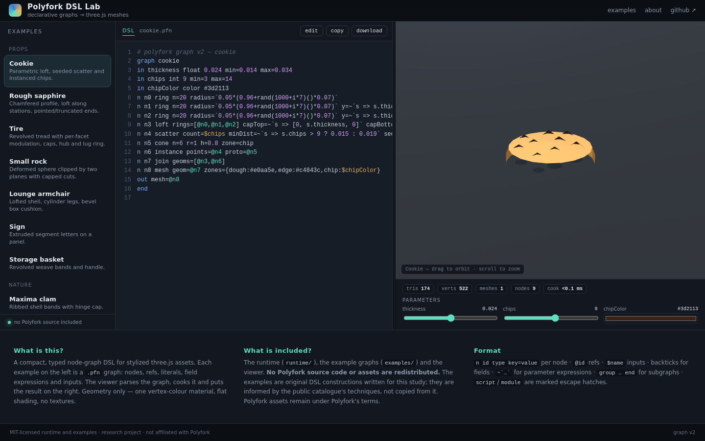

# Polyfork DSL Lab

A small, typed, declarative node-graph DSL for **stylized three.js assets** — with a browser
viewer that splits DSL source and the cooked mesh.

**Live demo:** https://mode777.github.io/polyfork-dsl-lab/



No build step, no textures, no node editor (yet). One vertex-colour material, flat shading,
geometry only.

---

## What is here

```
index.html            the split code / result viewer
app.js                viewer (three.js scene, params, live cook)
runtime/runtime.js    55-node typed graph runtime + evaluator
runtime/format.js     .pfn text parser and serializer
runtime/dsl.js        JavaScript authoring DSL
runtime/cache.js      content-addressed array pool + Float32 cache
examples/*.pfn        12 example graphs
docs/                 design notes, study, format, techniques
```

**No Polyfork source code or assets are included.** See `NOTICE`. The examples are original
DSL constructions written for this study; they are informed by publicly observable
techniques in the Polyfork catalogue, not copied from it.

## Run

```bash
python3 -m http.server 8000
# open http://localhost:8000
```

The viewer loads `examples/manifest.json`, fetches a `.pfn` graph, parses it with
`runtime/format.js`, cooks it with `runtime/runtime.js` and renders the mesh. Sliders and
colour pickers are generated from the graph's `in` declarations; inputs that are baked into
the graph are detected and hidden.

## The DSL

One line per node. Refs are explicit, defaults are omitted, fields are expressions.

```pfn
graph cookie
in thickness float 0.024 min=0.014 max=0.034
in chips int 9 min=3 max=14
n rim  ring n=20 radius=`0.05*(0.96+rand(1000+i*7)()*0.07)`
n body loft rings=[@rim] capTop=`~s => [0, s.thickness, 0]` zones={band:edge,capTop:dough}
n pts  scatter count=$chips seed=42 minDist=0.019
n chip instance points=@pts proto=@shape
n out  mesh geom=@body zones={dough:#e0aa5e,edge:#c4843c,chip:#3d2113}
out mesh=@out
end
```

- `@id` — node ref · `$name` — graph input
- `` `expr` `` — field expression, evaluated per vertex/index
- `` ~`expr` `` — parameter expression, evaluated once per cook (`s` = inputs)
- `group … end` — subgraph · `repeat count= graph=` — repeated subgraph
- `script` and `module` — explicit escape hatches (marked, never implicit)

The parser, serializer and evaluator are in `runtime/`. `.pfn` is the authoring form;
`cache.js` shows a compact content-addressed JSON cache (arrays pooled and base64-encoded,
≈84% smaller on graphs with repeated rings).

## Node set (55)

| group | nodes |
|---|---|
| sources | `ring profile path grid box chamferBox cylinder sphere plane card cone curl pointsGrid` |
| surfaces | `loft loftProfile cap extrude revolve sweep inset pocket solidify bevelProfile fan fanRing wrapShell` |
| modifiers | `transform center mirror deform clip join cavity` |
| distribution | `scatter scatterSurface scatterVolume instance instancedMesh arrayPolar arrayLinear` |
| character | `skeleton skin pose` |
| surface-relative | `pathOnSurface bandOnSurface ribbon` |
| control / text | `switch text boolean` |
| output | `mesh group` |
| escape hatches | `script module` |

## Examples

| example | what it shows |
|---|---|
| Cookie | parametric loft, seeded scatter, instanced chips |
| Rough sapphire | chamfered profile, loft along stations, pointed/truncated ends |
| Tire | revolved tread with per-facet modulation, caps, hub, lug ring |
| Small rock | deformed sphere clipped by two capped planes |
| Lounge armchair | loft shell, cylinder legs, bevel box cushion |
| Maxima clam | ribbed shell bands and hinge cap |
| Stylized hair | 6-triangle curl primitives scattered on a head volume |
| Stylized jacket | wrapped shell with a front gap, lining, lapels, collar |
| Sign | extruded segment letters on a panel |
| Creature (skinned) | lofted body, bone tree and soft skin weights |
| Storage basket | revolved weave bands and handle |
| Pumpkin | lobed revolve with stem |

## Design notes

- [docs/DESIGN.md](docs/DESIGN.md) — API, node signatures, format
- [docs/TECHNIQUES.md](docs/TECHNIQUES.md) — how the studied assets build hair, clothes, text
- [docs/STUDY.md](docs/STUDY.md) — three random samples, gap analysis, ring-array optimisation
- [docs/IMPROVEMENTS.md](docs/IMPROVEMENTS.md) — booleans, instancing, caching, research decisions
- [docs/FEASIBILITY.md](docs/FEASIBILITY.md) — the original feasibility study
- [docs/PORT_TEST.md](docs/PORT_TEST.md) — strict parity port test

## Scope and limitations

This is a **stylized geometry DSL**, not a full DCC. It has no node editor, no textures, no
UVs, no cloth simulation and no general grooming. The examples are original constructions,
not byte-identical ports. Booleans use `manifold-3d` (WASM, loaded lazily; no example needs
it).

## Licence

MIT for the runtime, format, viewer and example graphs. Polyfork names and assets remain
the property of their author; see `NOTICE`. Not affiliated with or endorsed by Polyfork.
