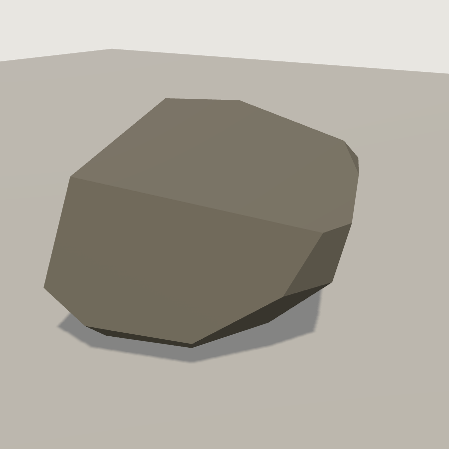
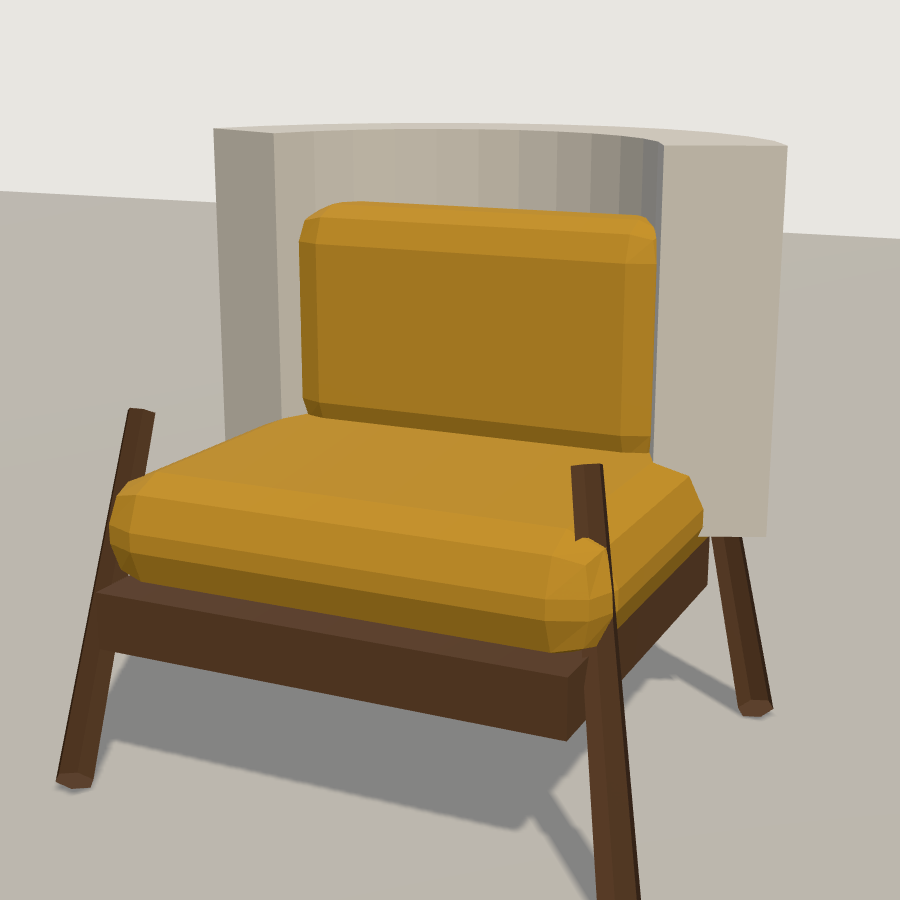
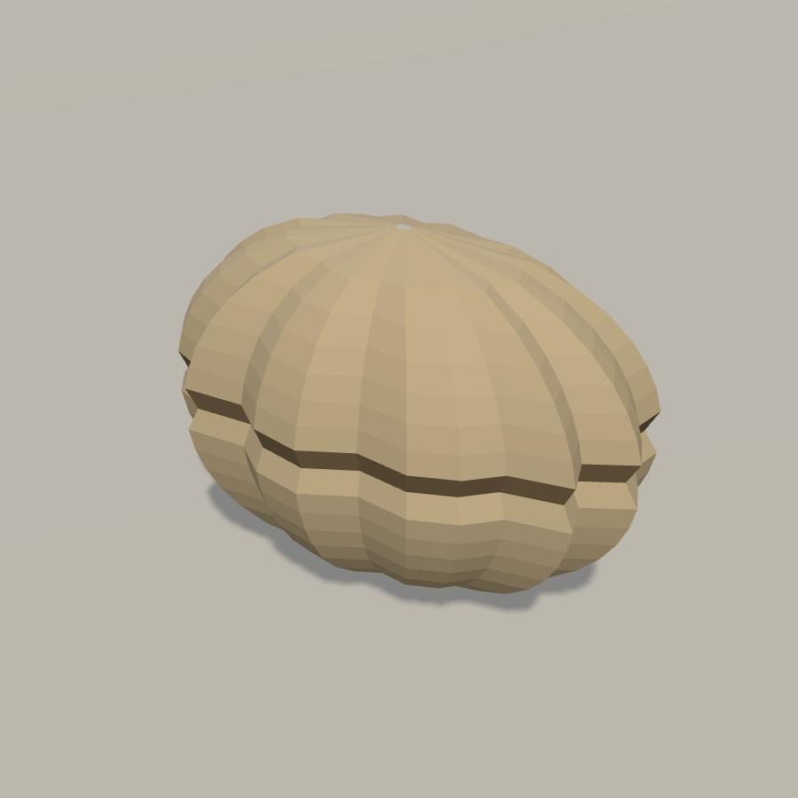
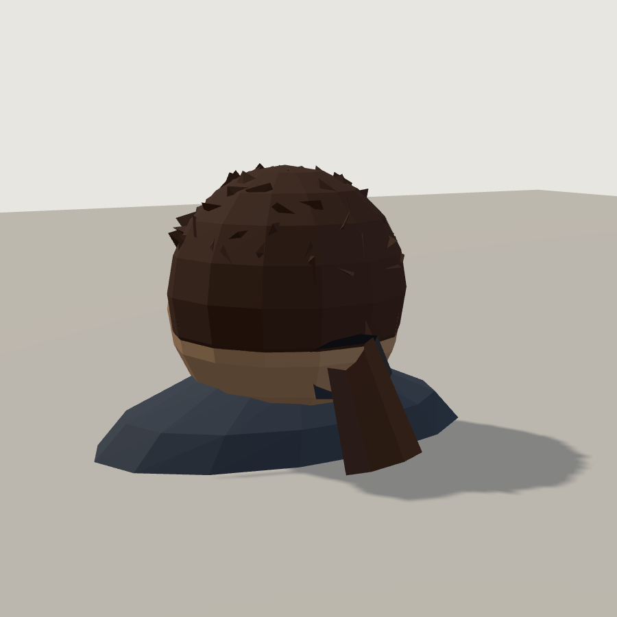
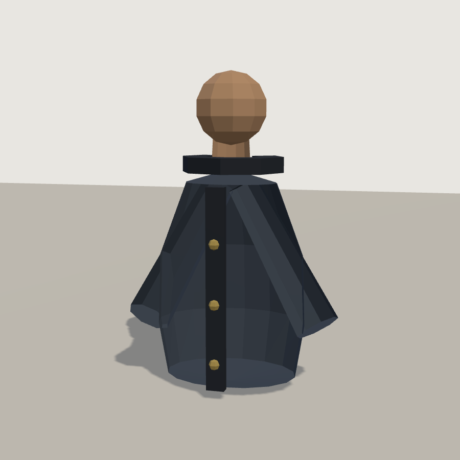
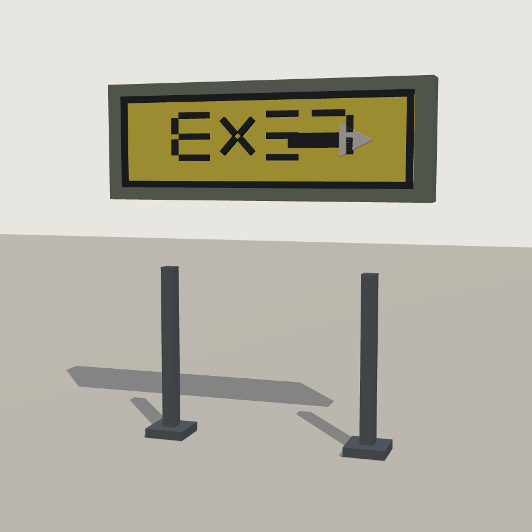
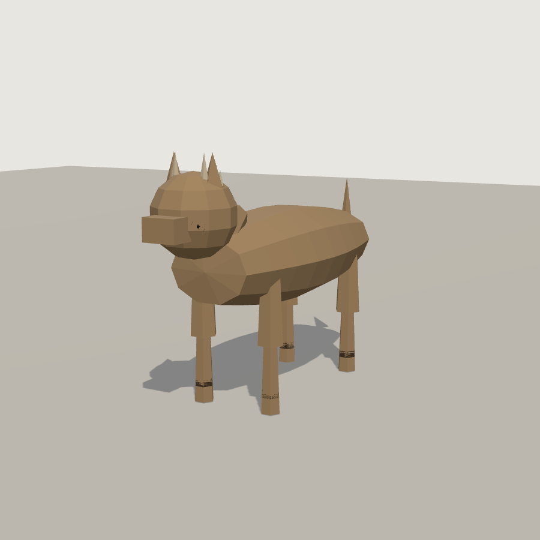
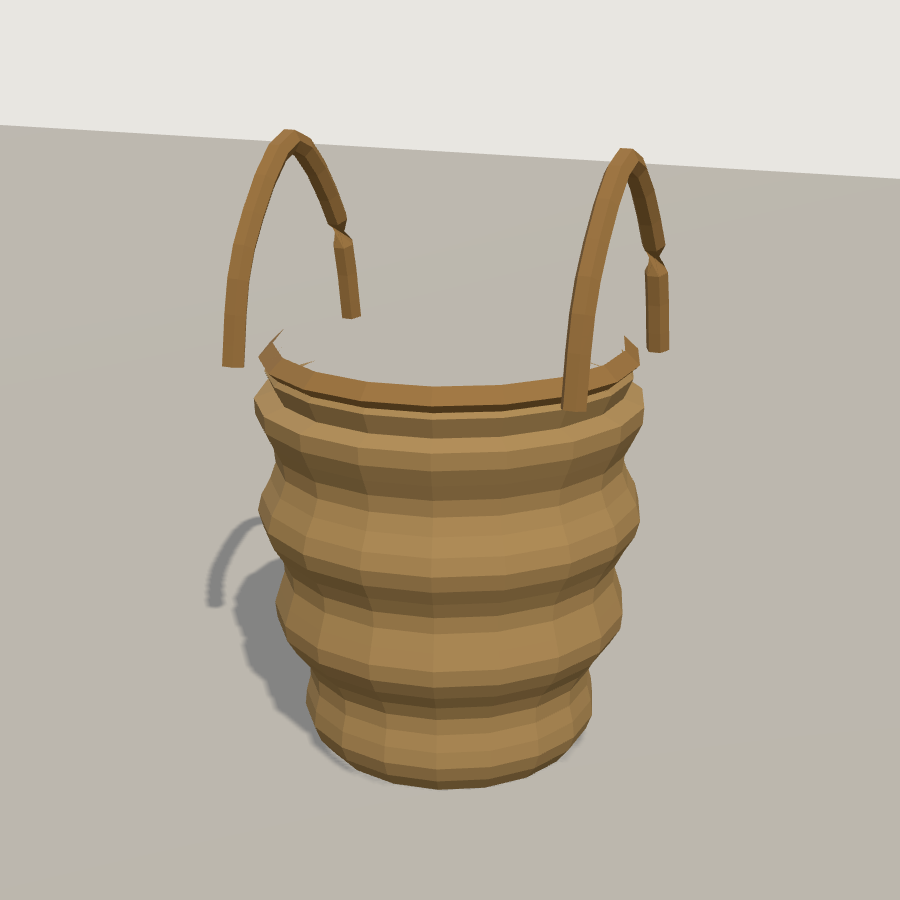

# Gallery

Clean 900×900 renders of the 12 example graphs (inspector lighting, per-example camera).
These are indicative screenshots; the cookie/sapphire/tire images predate the geometric
parity pass and should be regenerated. See `STATUS.md` for the current port status.

| | |
|---|---|
|  **Cookie** |  **Rough sapphire** |
|  **Tire** |  **Small rock** |
|  **Lounge armchair** |  **Maxima clam** |
|  **Stylized hair** |  **Stylized jacket** |
|  **Sign** |  **Creature (skinned)** |
|  **Storage basket** |  **Pumpkin** |
