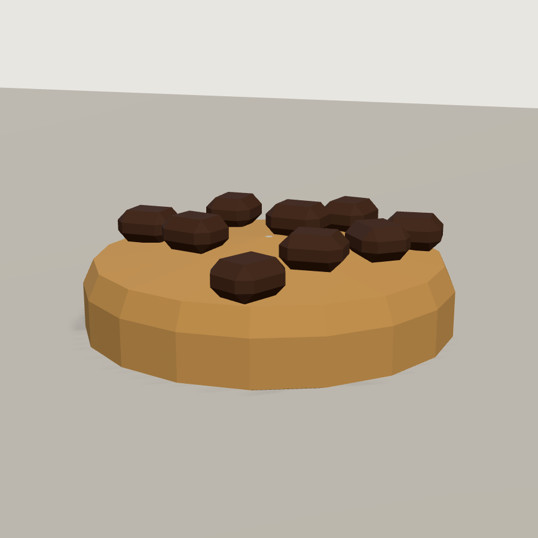
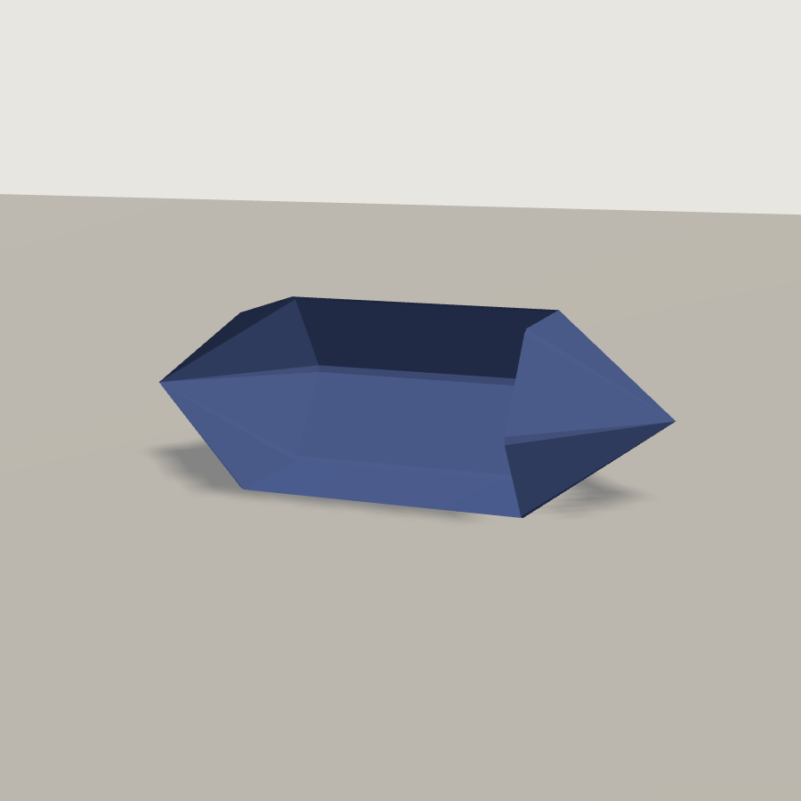
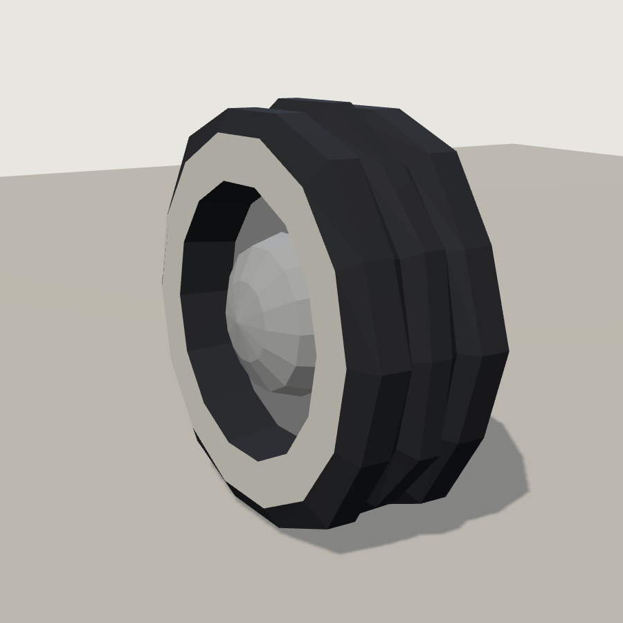
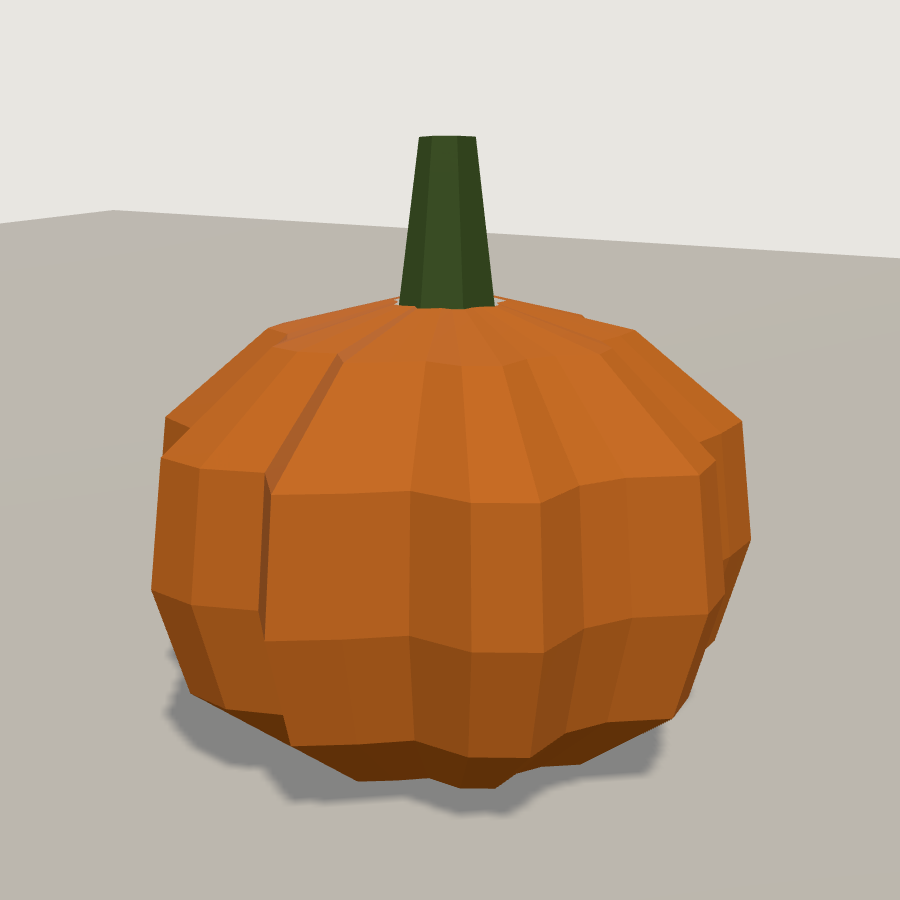

# Gallery

The showcase currently contains **ports only**. The live viewer is the source of truth:
<https://mode777.github.io/polyfork-dsl-lab/>.

The cookie/sapphire/tire images predate the parity pass; the pumpkin image is the old
approximation. The other twenty-five ports — rug, chalkboard, theatre, wayfinding, desk, plaza, clam,
tram, armchair, wattle, quiver, door, taxiway, roof, carousel, prize, grass, coral,
rowboat, basket, contextmenu, lookout, cafe, keyboard and chair — have no current gallery
capture yet. Regenerate after the next render pass.

| | |
|---|---|
|  **Cookie** |  **Rough sapphire** |
|  **Tire** |  **Pumpkin** |

The remaining twenty-five ports are shown in the live viewer; images pending.
